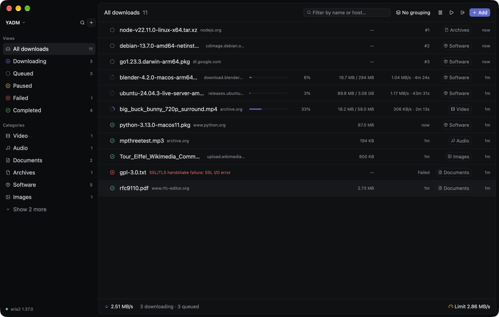
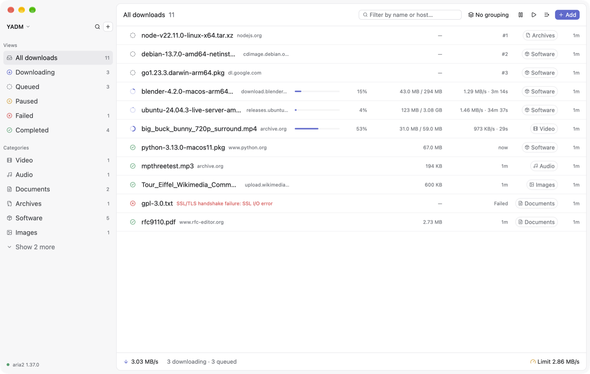

# YADM

**Yet Another Download Manager**: a native, keyboard-first download manager for macOS, Windows and Linux.

YADM is written in Rust on [GPUI](https://www.gpui.rs) + [GPUI Kit](https://gpui-kit.com) (shadcn-based
components) and uses [aria2](https://aria2.github.io) as its download engine. The UI follows Linear: an inset
content panel, grouped dense lists, a detail sidebar, a ⌘K command palette and a quiet indigo theme in light
and dark.



<details>
<summary>Light theme</summary>



</details>

## Features

- **HTTP(S), FTP, BitTorrent and magnet links**: segmented downloads with several connections per file,
  resumed across restarts.
- **Queue control**: a configurable number of simultaneous downloads (default 1); the rest wait in the
  queue and can be reordered.
- **Organised automatically**: downloads are grouped by category (video, audio, documents, archives,
  software, images, torrents), with per-category folders (on by default).
- **Browser integration**: an MV3 extension for Chrome, Edge and Firefox hands downloads to YADM with cookies,
  referrer and user agent.
- **Clipboard monitor**: offers to download links to files and magnets you copy.
- **Scheduler**: limit speed or pause everything at certain times.
- **Bandwidth limits** and seeding ratio for torrents.
- **Menu bar / system tray icon** with live speed and quick controls.
- **Keyboard first**: almost everything has a shortcut, plus a fuzzy command palette.
- **Interface size**: follows the system (including GNOME's text scaling on Linux) or 90–150%.

## Platforms

| | macOS | Windows | Linux |
| --- | --- | --- | --- |
| App | ✓ | ✓ | ✓ |
| Bundled aria2 | `YADM.app` | next to `YADM.exe` | next to `yadm` |
| Tray icon / close to tray | menu bar | system tray | system tray (StatusNotifierItem) |
| Shortcut modifier | ⌘ | Ctrl | Ctrl |
| Data folder | `~/Library/Application Support/YADM` | `%APPDATA%\YADM` | `~/.local/share/YADM` |

The data folder holds `settings.toml`, `yadm.db` (history) and `engine/` (aria2 session and log).

## Build and run

### macOS

```sh
brew install aria2          # dev only; release builds bundle their own
cargo run -p yadm-app
```

Package a self-contained app:

```sh
scripts/build-aria2.sh      # → vendor/aria2c, links only system libs (AppleTLS)
scripts/bundle-macos.sh     # → dist/YADM.app (ad-hoc signed)
```

### Windows

Needs the MSVC toolchain (Visual Studio Build Tools with the C++ workload).

```powershell
winget install aria2.aria2  # dev only (or scoop/choco install aria2)
cargo run -p yadm-app
```

Package (fetches the official `aria2c.exe` into `vendor\` unless `-Aria2c` is given):

```powershell
powershell -ExecutionPolicy Bypass -File scripts\bundle-windows.ps1
# → dist\YADM\ and dist\YADM-<version>-windows-x64.zip
```

Closing the window keeps YADM running in the system tray while **Keep running when the window closes** and
**Show in system tray** are on. Click the tray icon to bring it back and right-click it for the menu.

### Linux

Building natively needs the `-dev` packages for fontconfig, freetype, xkbcommon, Wayland and X11. To keep them
off your machine, build in Docker instead. The script also compiles a portable `aria2c` and bundles it, so the
host needs nothing beyond the libraries every desktop already has:

```sh
scripts/build-linux.sh      # → dist/YADM-linux/{yadm, aria2c, extension/}
dist/YADM-linux/yadm
docker rmi yadm-build       # drop the build image when done
```

The tray icon uses the StatusNotifierItem D-Bus protocol, which KDE, Xfce and Cinnamon show natively and GNOME
shows with the AppIndicator extension (on by default in Ubuntu). Without a tray host, closing the window quits.
On first launch YADM registers `~/.local/share/applications/dev.yadm.app.desktop` and its icon so the desktop
shows its name and icon.

### Engine discovery

`YADM_ARIA2C=/path/to/aria2c` overrides everything. Otherwise YADM looks next to its own executable, then on
`PATH`, then in the Homebrew, Scoop, Chocolatey and winget locations.

### Tests

```sh
cargo test --workspace      # unit + integration tests (real aria2c, skipped if missing)
```

## Keyboard

Shortcuts are listed with macOS keys. On Windows and Linux ⌘ is Ctrl and ⌥ is Alt (e.g. ⌥⌘P → Ctrl+Alt+P).

| Keys | Action |
| --- | --- |
| ⌘N / ⌘V | New download / paste links |
| ⌘K | Command palette |
| j k ↑ ↓ | Move |
| x, ⌘A, shift/⌘-click | Select |
| Space / Enter | Toggle details |
| p | Pause / resume |
| r | Retry |
| ⌫ / ⌘⌫ | Remove / remove and trash files |
| ⌘O / ⌘⇧O | Show in Finder/Explorer / open |
| ⌘⇧C | Copy source URL |
| ⌥↑ ⌥↓ | Reorder queue |
| / or ⌘F | Filter |
| ⌘1…⌘6 | Views |
| ⌥⌘P / ⌥⌘R | Pause all / resume all |
| ⌘, | Settings |
| ⌘W | Hide window |

## Browser extension

Load `extension/` unpacked (chrome://extensions → Developer mode → Load unpacked; **Settings → Browser → Show
folder** opens it; in Firefox use `about:debugging` or a signed `.xpi`). The extension pairs itself: on install
(or its first download) YADM asks **Connect Firefox to YADM?**, and **Allow** hands the extension its token. The
token is also in **Settings → Browser** if you'd rather paste it into the extension's options.
Downloads are cancelled in the browser and sent to YADM. If YADM isn't running, the browser keeps the
download.

The bridge listens on `127.0.0.1` only, requires the token, and accepts browser requests only from extension
origins. Pairing (`POST /v1/pair`) returns the token only after the user allows it in YADM, one request at a
time.

## Architecture

```
crates/aria2    async JSON-RPC (WebSocket) client + aria2c sidecar process manager
crates/core     domain model, SQLite history, sync loop, scheduler, settings, engine actor
crates/bridge   localhost HTTP endpoint for the browser extension (token + Origin checked)
crates/app      the GPUI app: views, Linear theme, tray icon, clipboard monitor, per-OS glue
themes/         linear.json: Linear Dark / Linear Light for gpui-component
extension/      MV3 extension (Chrome, Edge, Firefox)
scripts/        build-aria2.sh, bundle-macos.sh, bundle-windows.ps1, build-linux.sh
```

The UI never touches tokio: `yadm-core` runs an engine actor on its own runtime thread. The app sends
`Command`s and receives `Event`s (snapshots, toasts, details) over channels. aria2's session file resumes
partial transfers, and SQLite keeps stable ids, categories and history that aria2 forgets after a restart.

Per-OS differences live in `crates/app/src/platform.rs`. All UI sizes go through `ui::kit::dp()` so the
interface scales as one.

## License

MIT (see `license` in `Cargo.toml`).
